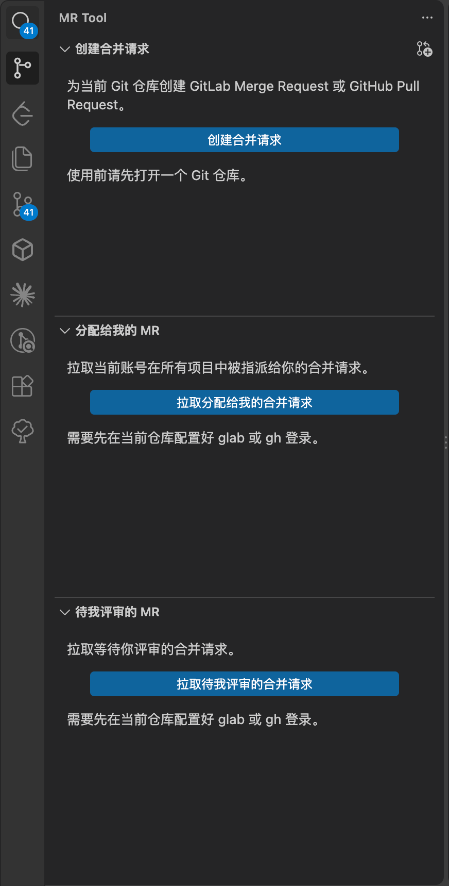
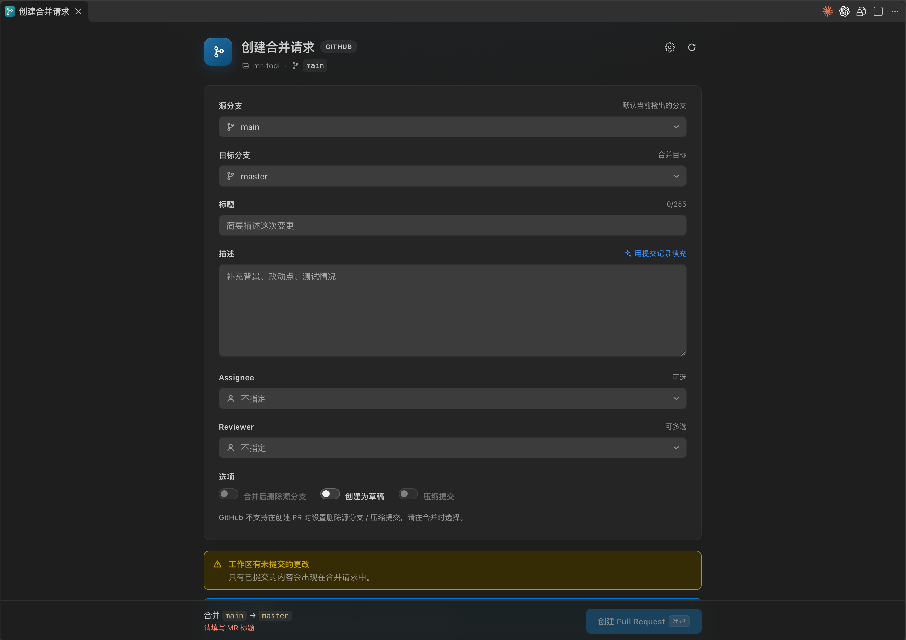
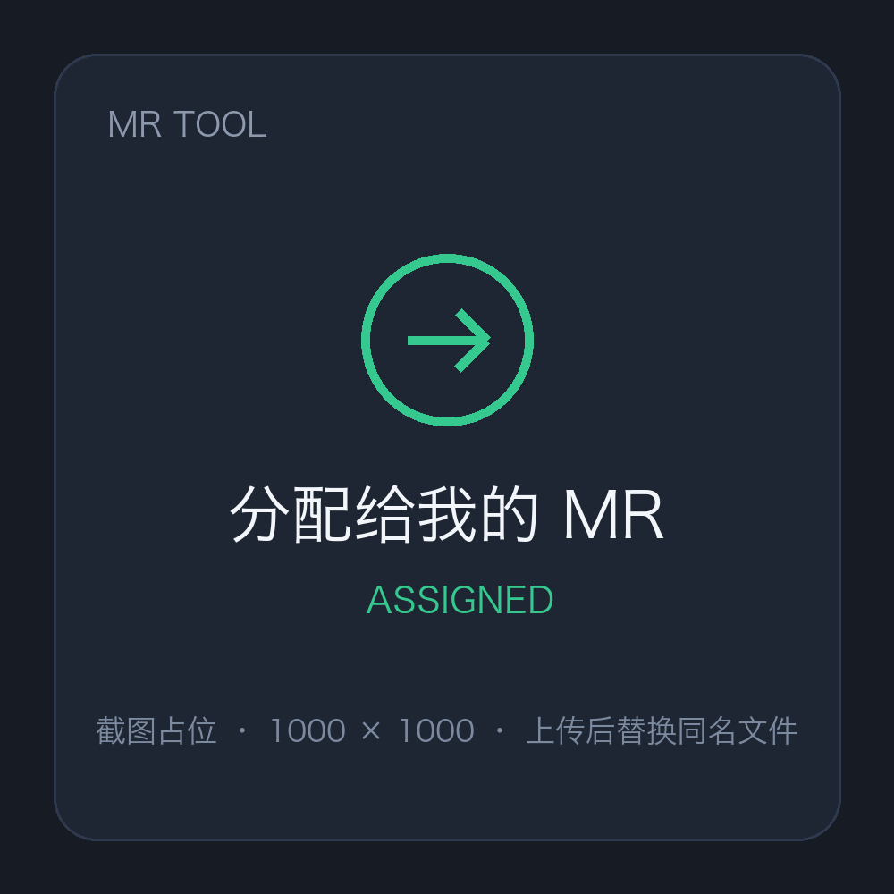
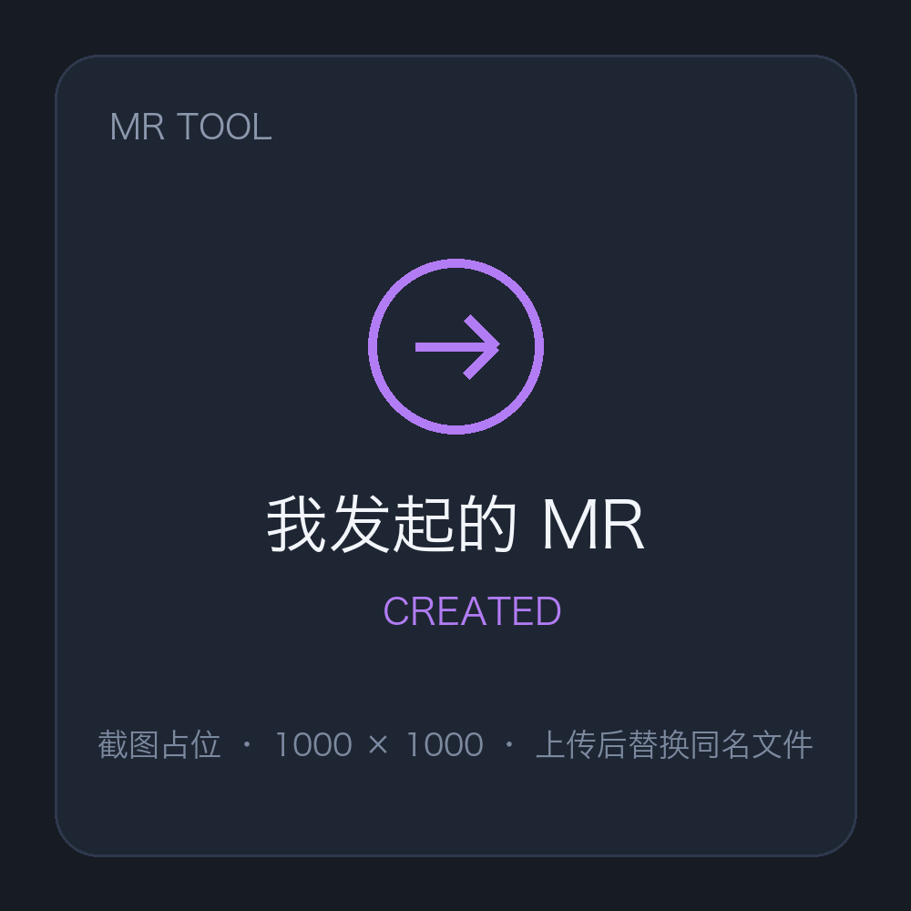

# MR Tool

Create GitLab Merge Requests / GitHub Pull Requests from a graphical panel inside VS Code, and manage the MRs assigned to you, waiting for your review, and created by you in one sidebar.

No commands to memorize, no switching to the browser, no typing branch names by hand.

**English** | [简体中文](README.zh-CN.md)

## Screenshots

### Sidebar overview

### Create a merge request

### MRs assigned to me

### MRs waiting for my review

### MRs I created / edit panel

## Features

- Graphical MR / PR creation: source branch, target branch, title, description, assignee, reviewers, draft, delete source branch, squash
- Detects MR / PR templates in the repository and applies them with one click
- Auto-fills the title and description from the latest commit on the source branch
- Checks for an existing open MR before creating a duplicate
- Shows commits, changed files, additions and deletions against the target branch
- Three sidebar views: assigned to me, waiting for my review, created by me (grouped by project)
- Quality status at a glance: conflicts, CI / pipeline failures, checks running, checks passed
- Merge, approve, mark ready, close, checkout locally, copy link
- Edit the title and description of MRs you created
- Remembers the last target branch, assignee, reviewers and toggles per repository
- Sends Feishu group notifications after creating or merging an MR, with configurable prefixes, templates and @mentions
- Status bar shows the MR for the current branch; click to open it
- Works with GitLab and GitHub, detected automatically

## Usage

1. Open any Git repository in VS Code
2. Click the **MR Tool** icon in the Activity Bar, or run `MR: Create Merge Request` from the Command Palette
3. Confirm the source and target branches, fill in the title and description, choose assignees / reviewers and options
4. Click **Create Merge Request** (or press `⌘/Ctrl + Enter`)
5. When it succeeds you can open the MR, copy its link, or switch to the target branch

The three sidebar views load only after you click their **Fetch** link:

- **Assigned to me**: open MRs assigned to you
- **Waiting for my review**: open MRs awaiting your review
- **Created by me**: open MRs you created

## Requirements

- VS Code 1.85+
- `git`
- One of the following CLIs, installed and authenticated (optional):
  - GitLab: `glab auth login --hostname <your-gitlab-host>`
  - GitHub: `gh auth login`

Without a CLI you can still create MRs: the extension opens the web creation page with branches, title and description prefilled. The sidebar lists and merge / approve actions require a CLI.

## Configuration

| Setting | Default | Description |
| --- | --- | --- |
| `mrTool.platform` | `auto` | `auto` / `gitlab` / `github`; set manually when auto-detection fails |
| `mrTool.defaultAssignees` | `[]` | Pinned assignee candidates, e.g. `[{ "username": "...", "name": "..." }]` |
| `mrTool.defaultReviewers` | `[]` | Pinned reviewer candidates, same format |
| `mrTool.autoFetch` | `true` | Run `git fetch --prune` when the panel opens |
| `mrTool.recentBranchLimit` | `50` | Number of target branch candidates |
| `mrTool.feishuWebhook` | empty | Feishu bot webhook URL; leave empty to disable notifications |
| `mrTool.feishuPrefix` | empty | Global default prefix for Feishu messages, e.g. `Note: ` |
| `mrTool.feishuCreatePrefix` | empty | Prefix for create notifications; falls back to the global prefix |
| `mrTool.feishuMergePrefix` | empty | Prefix for merge notifications; falls back to the global prefix |
| `mrTool.feishuManualPrefix` | empty | Prefix for manually sent messages |
| `mrTool.feishuCreateTemplate` | see default | Body template for create notifications; supports `{project}` `{title}` `{url}` `{source}` `{target}` `{mentions}` |
| `mrTool.feishuMergeTemplate` | see default | Body template for merge notifications; supports `{project}` `{title}` `{url}` `{iid}` `{number}` `{mentions}` |
| `mrTool.feishuMentions` | `[]` | Users to @mention; set `id` to an open_id or `all` |
| `mrTool.feishuNotifyOnCreate` | `true` | Send a Feishu notification after creating an MR |
| `mrTool.feishuNotifyOnMerge` | `true` | Send a Feishu notification after merging an MR |

To enable Feishu notifications, add a custom bot to your group and put its webhook URL in `mrTool.feishuWebhook`. You can also run `MR: Send Feishu Notification` to send a message manually.
