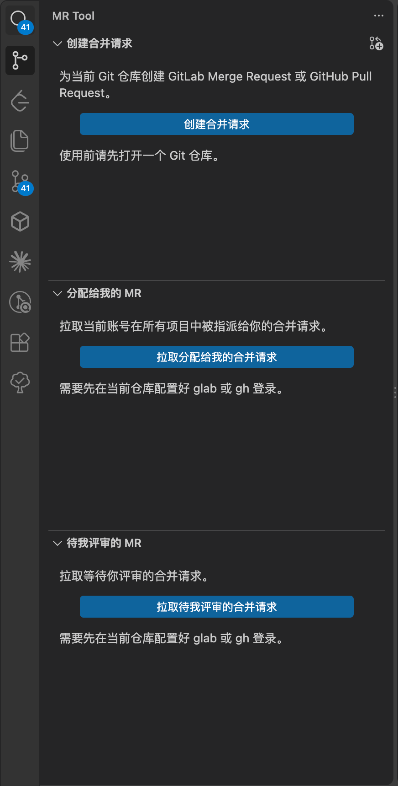
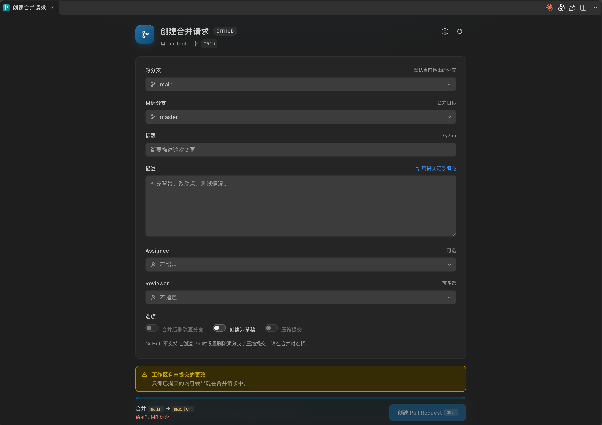
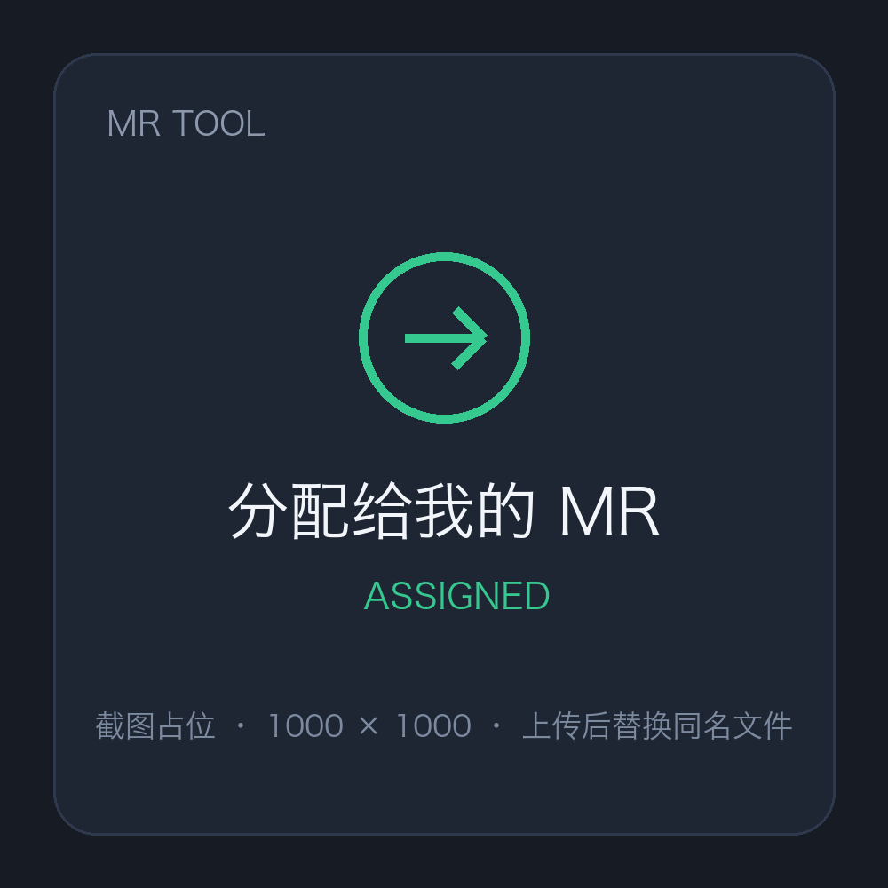
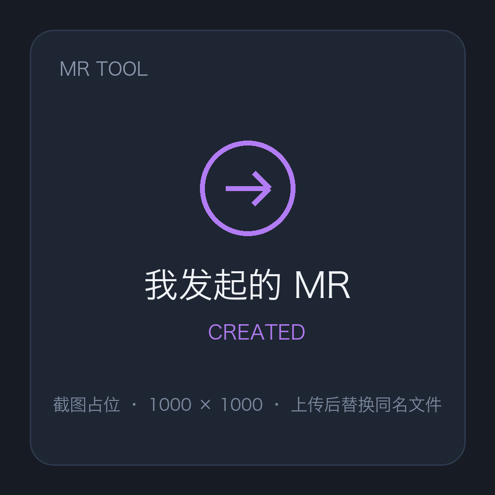

# MR Tool

[English](README.md) | **简体中文**

在 VS Code 里图形化创建 GitLab Merge Request / GitHub Pull Request，并把「分配给我」「待我评审」「我发起」的 MR 集中在一个侧边栏里管理。

不用记命令、不用切浏览器、不用手动拼分支名。

## 界面截图

### 侧边栏总览

### 创建合并请求

### 分配给我的 MR

### 待我评审的 MR

### 我发起的 MR / 编辑

## 能做什么

- 图形化创建 MR / PR：源分支、目标分支、标题、描述、Assignee、Reviewer、草稿、删除源分支、压缩提交
- 自动读取仓库里的 MR / PR 模板，一键套用
- 标题和描述自动取源分支最近一次提交，可继续修改
- 创建前检查是否已有打开的 MR，避免重复提交
- 显示相对目标分支的提交数、文件数、增删行数和提交列表
- 三个侧边栏视图：分配给我的、待我评审的、我发起的（均按项目分组）
- 列表直接显示质量状态：冲突、CI / 流水线失败、检查中、检查通过
- 支持合并、批准、标记可评审、关闭、检出到本地、复制链接
- 我发起的 MR 可以直接编辑标题和描述
- 按仓库记住上次的目标分支、Assignee、Reviewer 和选项
- 创建 / 合并成功后自动发送飞书群通知，消息可配置前缀、模板和 @ 人
- 状态栏显示当前分支的 MR，点击直接打开
- 支持 GitLab 和 GitHub，自动识别平台

## 使用

1. 用 VS Code 打开任意 Git 仓库
2. 点击左侧活动栏的 **MR Tool** 图标，或命令面板执行 `MR: 创建合并请求`
3. 确认源分支和目标分支，填写标题/描述，选择 Assignee / Reviewer 和选项
4. 点击「创建 Merge Request」（或 `⌘/Ctrl + Enter`）
5. 创建成功后可直接打开 MR、复制链接或切换到目标分支

侧边栏的三个视图需要手动点击「拉取…」才会加载：

- **分配给我的 MR**：指派给你的未合并请求
- **待我评审的 MR**：等待你评审的未合并请求
- **我发起的 MR**：你创建、尚未合并的请求

## 前置条件

- VS Code 1.85+
- `git`
- 已安装并登录任一 CLI（可选）：
  - GitLab：`glab auth login --hostname <你的 GitLab 域名>`
  - GitHub：`gh auth login`

没有 CLI 时仍可使用：创建 MR 时会打开网页创建页，自动带上分支、标题和描述；但侧边栏列表和合并 / 批准等操作需要 CLI。

## 配置

| 配置 | 默认值 | 说明 |
| --- | --- | --- |
| `mrTool.platform` | `auto` | `auto` / `gitlab` / `github`，自动识别失败时可手动指定 |
| `mrTool.defaultAssignees` | `[]` | Assignee 置顶候选，格式 `[{ "username": "...", "name": "..." }]` |
| `mrTool.defaultReviewers` | `[]` | Reviewer 置顶候选，格式同上 |
| `mrTool.autoFetch` | `true` | 打开面板时执行 `git fetch --prune` |
| `mrTool.recentBranchLimit` | `50` | 目标分支候选数量 |
| `mrTool.feishuWebhook` | 空 | 飞书群机器人 Webhook 地址，留空则不发送通知 |
| `mrTool.feishuPrefix` | 空 | 飞书消息全局默认前缀，如 `记录：` |
| `mrTool.feishuCreatePrefix` | 空 | 创建 MR 通知专用前缀，留空回退到全局前缀 |
| `mrTool.feishuMergePrefix` | 空 | 合并 MR 通知专用前缀，留空回退到全局前缀 |
| `mrTool.feishuManualPrefix` | 空 | 手动发送通知专用前缀 |
| `mrTool.feishuCreateTemplate` | 见默认值 | 创建通知正文模板，支持 `{project}` `{title}` `{url}` `{source}` `{target}` `{mentions}` |
| `mrTool.feishuMergeTemplate` | 见默认值 | 合并通知正文模板，支持 `{project}` `{title}` `{url}` `{iid}` `{number}` `{mentions}` |
| `mrTool.feishuMentions` | `[]` | 自动 @ 的用户，`id` 填 open_id 或 `all` |
| `mrTool.feishuNotifyOnCreate` | `true` | 创建 MR 成功后自动通知 |
| `mrTool.feishuNotifyOnMerge` | `true` | 合并 MR 成功后自动通知 |

飞书通知在群里添加「自定义机器人」后，把 Webhook 填到 `mrTool.feishuWebhook` 即可；也可以执行命令 `MR: 发送飞书通知` 手动发消息。
